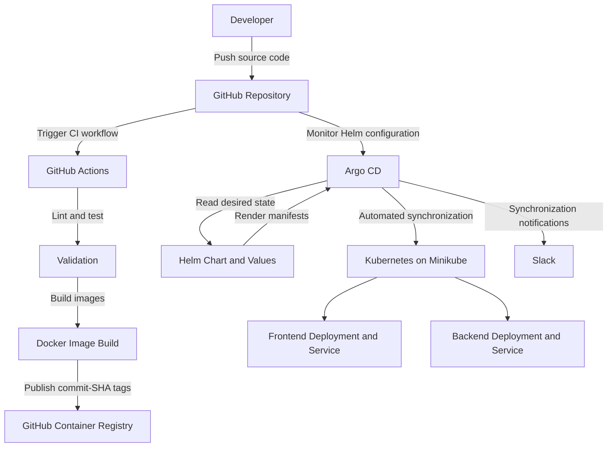

# DevOps Platform Internship

Enterprise-style DevOps platform being developed during the Parallax Labs DevOps Engineering Internship.

This repository is the single GitHub repository used throughout the internship. Work is added progressively to the same repository each week.

## Current Status

**Week 1 — Complete**

Week 1 establishes the microservice and Docker foundation for the project.

## Repository Structure

```text
.
|-- README.md
|-- services/
|   |-- frontend/
|   |   |-- app.py
|   |   |-- Dockerfile
|   |   `-- .dockerignore
|   |
|   `-- backend/
|       |-- app.py
|       |-- Dockerfile
|       `-- .dockerignore
|
|-- docs/
|-- week-1/
|   `-- verification.md
|-- week-2/
|-- week-3/
|-- week-4/
|-- week-5/
|-- week-6/
|-- infra/
|-- k8s/
|-- gateway/
|-- observability/
|
`-- .github/
    `-- workflows/
```

`services/` contains the microservice source code.

`week-1/verification.md` contains the detailed Week 1 verification record.

The remaining directories are reserved for work that will be added during later weeks.

## Prerequisites

The following tools were installed and verified during Week 1:

| Tool           | Version / Result |
| -------------- | ---------------- |
| WSL            | Version 2        |
| Docker Engine  | 29.4.0           |
| Docker Compose | v5.1.1           |
| kubectl        | v1.34.1          |
| Helm           | v4.3.0           |
| Terraform      | v1.16.4          |

### WSL

Verified with:

```powershell
wsl --list --verbose
```

Result:

```text
NAME              STATE           VERSION
* docker-desktop  Running         2
```

### Docker

Verified with:

```powershell
docker info --format '{{.ServerVersion}}'
```

Result:

```text
29.4.0
```

Docker was also verified with:

```powershell
docker run --rm hello-world
```

### Docker Compose

```powershell
docker compose version
```

Result:

```text
Docker Compose version v5.1.1
```

### kubectl

```powershell
kubectl version --client
```

Verified:

```text
Client Version: v1.34.1
Kustomize Version: v5.7.1
```

### Helm

```powershell
helm version
```

Verified:

```text
v4.3.0
```

### Terraform

```powershell
terraform version
```

Verified:

```text
Terraform v1.16.4
```

## Week 1 Architecture

The Week 1 implementation consists of two independent HTTP microservices running as Docker containers.

```text
                         Developer
                            |
                            v
                     GitHub Repository
                            |
                 +----------+----------+
                 |                     |
                 v                     v
          Frontend Service      Backend Service
             Port 8080             Port 8081
                 |                     |
                 v                     v
          Docker Container      Docker Container
             UID 1001              UID 1001
```

The frontend and backend are independent HTTP microservices.

## Frontend

Location:

```text
services/frontend/
```

The frontend listens on port `8080`.

### Endpoints

`GET /health`

Verified result:

```text
HTTP 200 OK
OK
```

`GET /info`

Verified result:

```json
{"service": "frontend", "version": "1.0.0"}
```

## Backend

Location:

```text
services/backend/
```

The backend listens on port `8081`.

### Endpoints

`GET /health`

Verified result:

```text
HTTP 200 OK
OK
```

`GET /info`

Verified result:

```json
{"service": "backend", "version": "1.0.0"}
```

## Docker Implementation

Both services use:

* Multi-stage Dockerfiles
* `python:3.14-slim`
* Non-root runtime user `1001`
* `.dockerignore`

## Build

Run these commands from the repository root.

### Frontend

```powershell
docker build -t frontend:week1 .\services\frontend
```

### Backend

```powershell
docker build -t backend:week1 .\services\backend
```

## Run

### Frontend

```powershell
docker run -d --name frontend-week1 -p 8080:8080 frontend:week1
```

### Backend

```powershell
docker run -d --name backend-week1 -p 8081:8081 backend:week1
```

## Verification

### Frontend

```powershell
curl.exe -i http://localhost:8080/health
curl.exe -i http://localhost:8080/info
```

Verified `/health` response:

```text
HTTP 200 OK
OK
```

Verified `/info` response:

```json
{"service": "frontend", "version": "1.0.0"}
```

### Backend

```powershell
curl.exe -i http://localhost:8081/health
curl.exe -i http://localhost:8081/info
```

Verified `/health` response:

```text
HTTP 200 OK
OK
```

Verified `/info` response:

```json
{"service": "backend", "version": "1.0.0"}
```

## Container User Verification

The configured Docker user was verified with:

```powershell
docker image inspect frontend:week1 --format '{{.Config.User}}'
docker image inspect backend:week1 --format '{{.Config.User}}'
```

Verified result:

```text
1001
1001
```

The running containers were also checked with:

```powershell
docker exec frontend-week1 id
docker exec backend-week1 id
```

The containers were verified to run with UID `1001`.

## Week 1 Verification Record

Detailed verification evidence is available in:

```text
week-1/verification.md
```

It records the prerequisite checks, Docker builds, container execution, endpoint tests, and non-root user verification completed during Week 1.

## Cleanup

Stop and remove the Week 1 containers:

```powershell
docker rm -f frontend-week1 backend-week1
```

Remove the local images if no longer needed:

```powershell
docker rmi frontend:week1 backend:week1
```

## Development Workflow

Changes are made locally and tracked with Git.

```powershell
git status
git add .
git commit -m "description of change"
git push
```

The same GitHub repository will be used throughout the internship.

## Security

The repository uses `.gitignore` to exclude common generated and sensitive local files.

Real passwords, API keys, access tokens, credentials, and other secrets must never be committed to the repository.


## Week 2 — Kubernetes, Helm, and Service Mesh

### Objectives

Week 2 extends the Week 1 Dockerized microservices into a local Kubernetes environment. A parameterized Helm chart deploys the frontend and backend services, and Istio provides service-mesh sidecars and strict mutual TLS (mTLS).

### Local Kubernetes Environment

The local Kubernetes cluster runs using Minikube with the Docker driver.

Verified tools:
- Minikube v1.39.0
- kubectl v1.34.1
- Helm v4.3.0

### Helm Chart

Chart location:

```text
helm/microservices/
```

The chart deploys the frontend and backend with configurable image repositories, tags, replica counts, ports, health probes, resource requests and limits, and container security contexts.

Both deployments use non-root UID `1001`, disable privilege escalation, and drop Linux capabilities.

Services are exposed internally as Kubernetes `ClusterIP` services:
- Frontend: port `8080`
- Backend: port `8081`

### Helm Validation

Validate the chart:

```powershell
helm lint .\helm\microservices
helm template microservices .\helm\microservices
```

The chart passed `helm lint` with zero failed charts. Rendered output was checked for both Deployments, both Services, and the strict mTLS policy.

### Istio Service Mesh

Istio was installed using Helm into the `istio-system` namespace. The `default` namespace was labeled for automatic sidecar injection, and the frontend and backend deployments were restarted to receive their proxies.

Verify the workloads:

```powershell
kubectl get pods
kubectl get deployments
```

Both application pods were verified as `2/2 Running`, indicating that their application containers and Istio sidecars were ready.

### Strict Mutual TLS

The `PeerAuthentication` resource in the `default` namespace is configured with:

```yaml
spec:
  mtls:
    mode: STRICT
```

Verify the policy:

```powershell
kubectl get peerauthentication default -n default -o yaml
```

### mTLS Connectivity Verification

An injected test client pod (`2/2 Running`) successfully requested the backend health endpoint:

```powershell
kubectl exec mtls-client -c mtls-client -- curl -sS --connect-timeout 5 http://microservices-backend:8081/health
```

Verified response:

```text
OK
```

An uninjected test pod's plaintext HTTP request previously failed with `Connection reset by peer`. This result is consistent with strict mTLS enforcement. The successful injected-client request, the configured `STRICT` policy, and the proxy TLS configuration provide supporting verification evidence.

Temporary test pods were removed after testing.

### Accessing Services Locally

Use separate PowerShell terminals for port forwarding:

```powershell
kubectl port-forward svc/microservices-frontend 8080:8080
```

```powershell
kubectl port-forward svc/microservices-backend 8081:8081
```

Then test the endpoints:

```powershell
Invoke-RestMethod http://127.0.0.1:8080/health
Invoke-RestMethod http://127.0.0.1:8081/health
```

Both endpoints returned `OK` during verification.

### Week 2 Status

Completed:
- Parameterized Helm chart for frontend and backend
- Local Minikube Kubernetes deployment
- Istio installation using Helm
- Automatic sidecar injection for application workloads
- `PeerAuthentication` configured for strict mTLS
- Injected-client backend connectivity test
- Helm lint and rendered-manifest validation


## Week 3 — Kong API Gateway and CI/CD

### Objectives

Week 3 adds Kong API Gateway in front of the frontend service, protects the route with API key authentication, applies rate limiting, and automates linting, testing, and Docker image publishing through GitHub Actions.

### Kong API Gateway

Kong is deployed in the local Minikube Kubernetes cluster in the `kong` namespace. Its declarative configuration is stored in:

```text
gateway/
|-- kong.yml
`-- kong-values.yaml
```

The configuration defines a route to the frontend Kubernetes Service:

```text
microservices-frontend.default.svc.cluster.local:8080
```

The Kong Helm chart is configured to use a declarative ConfigMap, with the database disabled.

### API Key Authentication

The Kong `key-auth` plugin protects the frontend route. Requests without a valid API key are rejected with `401 Unauthorized`.

For local testing, the configured demo consumer uses the API key:

```text
week3-demo-key-change-me
```

This is a development-only example key, not a production secret.

### Rate Limiting

The Kong `rate-limiting` plugin is configured for a limit of five requests per minute, using the local policy.

Requests include rate-limit response headers. When the configured limit is exceeded, Kong returns `429 Too Many Requests`.

### Accessing Kong Locally

Use a PowerShell terminal to forward local port `8000` to the Kong proxy service:

```powershell
kubectl port-forward -n kong service/kong-kong-proxy 8000:80
```

Keep this terminal running while testing Kong from another PowerShell terminal.

### Verification

Test that requests without an API key are rejected:

```powershell
curl.exe -i http://localhost:8000/health
```

Expected result:

```text
401 Unauthorized
```

Test the frontend health endpoint with the demo API key:

```powershell
curl.exe -i -H "apikey: week3-demo-key-change-me" http://localhost:8000/health
```

Expected result:

```text
200 OK
OK
```

The rate limit can be verified by sending repeated requests with the API key and checking the response status and rate-limit headers. Once the limit is exceeded within the configured minute, Kong returns `429 Too Many Requests`.

### GitHub Actions CI/CD

The workflow is located at:

```text
.github/workflows/ci.yml
```

It runs on pushes to `main` and pull requests targeting `main`.

The workflow performs the following steps:

1. Checks out the repository.
2. Sets up Python.
3. Runs Ruff lint checks for the frontend and backend services.
4. Runs each service's Python unit tests.
5. Builds Docker images after the test job succeeds.
6. Publishes both images to GitHub Container Registry (GHCR).

### Unit Tests

Tests are located in:

```text
services/frontend/tests/
services/backend/tests/
```

They cover the health endpoint, service information endpoint, and handling of unknown paths.

### Docker Image Publishing

The workflow builds and pushes these images:

```text
ghcr.io/hifzandocker/frontend:<commit-sha>
ghcr.io/hifzandocker/backend:<commit-sha>
```

Each image is tagged with the Git commit SHA that triggered the workflow. This makes published builds identifiable and traceable to their source revision.

The workflow uses GitHub Actions' `GITHUB_TOKEN` to authenticate with GHCR and grants the required package-write permission.

### Week 3 Status

Completed and verified:

- Kong API Gateway installed in Minikube
- Frontend route configured through Kong
- API key authentication enabled
- Rate limiting configured for five requests per minute
- Unauthorized requests rejected
- Authenticated frontend health requests returned `200 OK`
- Rate limiting verified through `429 Too Many Requests`
- GitHub Actions linting and unit tests passed
- Frontend and backend Docker images published to GHCR with commit-SHA tags


## Week 4: GitOps Continuous Deployment

### Objectives and Implementation

- Installed and configured Argo CD in the Kubernetes cluster running on Minikube.
- Configured the Argo CD application `microservices-gitops` to monitor the GitHub repository using Helm.
- Enabled automated synchronization, pruning, and self-healing.
- Configured frontend and backend deployments using Helm values stored in Git.
- Configured Slack notifications for Argo CD synchronization events and verified that a notification was delivered successfully.
- Verified frontend and backend health endpoints returned `200 OK`.

### GitOps Auto-Sync Verification

**Test date:** October 29, 2026

**Test procedure:**

1. Recorded the initial deployment state: frontend `2/2` replicas ready and backend `1/1` replica ready.
2. Changed `frontend.replicaCount` from `2` to `3` in `helm/microservices/values-gitops.yaml`.
3. Committed the change as `7769d5f`.
4. Pushed the commit to the `main` branch on GitHub.
5. Verified that Argo CD detected the new Git revision.
6. Verified that Kubernetes automatically scaled the frontend deployment to three ready replicas without manually changing the deployment.

**Results:**

- Git push: Successful
- Test commit: `7769d5fec3b7ebad6a0e76b4a10eae7a57fe995f`
- Argo CD sync status: `Synced`
- Argo CD health status: `Healthy`
- Frontend deployment: `3/3` replicas ready
- Backend deployment: `1/1` replica ready
- Recorded observation window: Approximately 6 minutes and 30 seconds, from the timestamp recorded before the push to the final time check.

**Conclusion:** The test demonstrated that a change to the Helm configuration in Git was detected by Argo CD and reflected in the Kubernetes deployment automatically. The recorded observation window is approximate; the exact time at which all replicas became ready was not captured.

### Deployed Container Images

The running frontend and backend deployments were verified to use the following images from GitHub Container Registry (GHCR):

| Service | Image |
|---|---|
| Frontend | `ghcr.io/hifzandocker/frontend:e370cf4c0f0661801fd9fa06b6fc5fd4056fdc0a` |
| Backend | `ghcr.io/hifzandocker/backend:e370cf4c0f0661801fd9fa06b6fc5fd4056fdc0a` |

These are commit-SHA-tagged images. The image tags were verified in the running Kubernetes deployments. The corresponding GitHub Actions workflow should also be checked to confirm that it publishes these exact tags.

### GitOps Architecture



### Workflow Explanation

1. **Source control:** Application code and Kubernetes deployment configuration are maintained in GitHub.
2. **Continuous integration:** GitHub Actions runs the configured linting and unit tests and builds container images.
3. **Image registry:** Built images are published to GHCR using commit-SHA tags.
4. **Continuous deployment:** Argo CD monitors the Git repository and uses the Helm chart and `values-gitops.yaml` to define the desired Kubernetes state.
5. **Automated synchronization:** Argo CD applies detected configuration changes to Kubernetes according to its automated sync policy.
6. **Health verification:** Kubernetes deployment readiness and the application health endpoints are checked to confirm that services are running.
7. **Notifications:** Argo CD sends synchronization notifications to Slack when the configured notification triggers are met.

### Prerequisites

- Docker
- Git
- kubectl
- Minikube
- Helm
- A GitHub account and access to the project repository
- An Argo CD installation and a Slack incoming webhook for notifications

### Verification Commands

Check Argo CD application status:

```powershell
kubectl get application microservices-gitops -n argocd
```

Check deployed workloads:

```powershell
kubectl get deployments -n gitops-demo
kubectl get pods -n gitops-demo
kubectl get services -n gitops-demo
```

Check deployed container image tags:

```powershell
kubectl get deployments -n gitops-demo -o jsonpath="{range .items[*]}{.metadata.name}{': '}{range .spec.template.spec.containers[*]}{.image}{' '}{end}{'\n'}{end}"
```

Render the Helm chart locally to inspect the generated Kubernetes manifests:

```powershell
helm template microservices-gitops helm/microservices -f helm/microservices/values-gitops.yaml
```

Check the current Git revision:

```powershell
git rev-parse HEAD
```

### Security Notes

- Store Slack webhook URLs in Kubernetes Secrets, not in Git-tracked files or README documentation.
- Never commit passwords, tokens, or webhook URLs.
- Rotate any webhook URL that has been exposed.
- Keep container images pinned to specific tags rather than relying on the mutable `latest` tag.

### Week 4 Outcome

The project demonstrates Git-based deployment configuration with Argo CD, automated synchronization, Helm-managed Kubernetes workloads, and Slack notification integration. A real configuration change was pushed to GitHub and verified in the running Kubernetes deployment.

Before final submission, verify that the GitHub Actions workflow publishes the same image tags referenced by the Helm values and that Slack notifications are still working with a valid, secured webhook.
